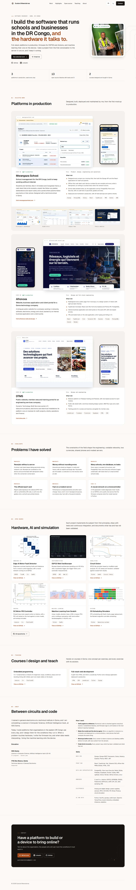

# guelord-mwenderwa.github.io

Personal portfolio of **Guelord Mwenderwa**, software engineer in Goma, DR Congo: platforms in production, embedded systems, machine learning and teaching.

**Live:** https://guelord-mwenderwa.github.io/ · French version: https://guelord-mwenderwa.github.io/fr/



## How it is built

A static site with no framework and no client-side build: HTML generated by a small Python script, one stylesheet and one short script. GitHub Pages serves the repository as it is.

| Path | Role |
| --- | --- |
| `content/en.toml`, `content/fr.toml` | All the text of the site, one file per language |
| `content/contributions.toml` | Pull requests opened on other projects (section shown when the file has entries) |
| `tools/build.py` | Generates `index.html`, `fr/index.html`, `404.html`, `sitemap.xml` and the share-card templates |
| `tools/images.py` | Converts source images to WebP in two widths (`assets/img/`) |
| `tools/og.mjs` | Renders the 1200 × 630 share images (`assets/og-en.png`, `assets/og-fr.png`) |
| `tools/apercu.mjs` | Full-page captures at 390 and 1440 px, light and dark, with overflow and error checks |
| `tools/check.py` | Design guard: no colour, font size or radius outside the tokens, no inline style, no image without alt text |
| `assets/site.css` | Design tokens (light and dark) and every style of the site |

## Update the site

```bash
python3 tools/build.py      # after editing content/*.toml
python3 tools/check.py      # must print "0 problème(s)"
node tools/og.mjs           # only when the hero text changes
```

Captures (Playwright installed globally):

```bash
python3 -m http.server 8765 --bind 127.0.0.1 &
node tools/apercu.mjs --serveur http://127.0.0.1:8765
node tools/apercu.mjs index.html fr/index.html --sombre --serveur http://127.0.0.1:8765
```

## Design

- Copper accent, the metal of printed circuit traces and of the DR Congo's copper belt, on warm neutrals tinted towards it. Every text colour passes WCAG AA (4.5:1) in both themes.
- Geist and Geist Mono; one type scale of eight sizes; three radii; two shadows.
- Mockup first: the page itself is the mockup, captured at phone (390 px) and desktop (1440 px) widths in `docs/maquettes/`.

## Credits and licence

Code: MIT licence (`LICENSE`). Text, portrait, product screenshots and figures: © Guelord Mwenderwa (`assets/img/ATTRIBUTIONS.md`).
